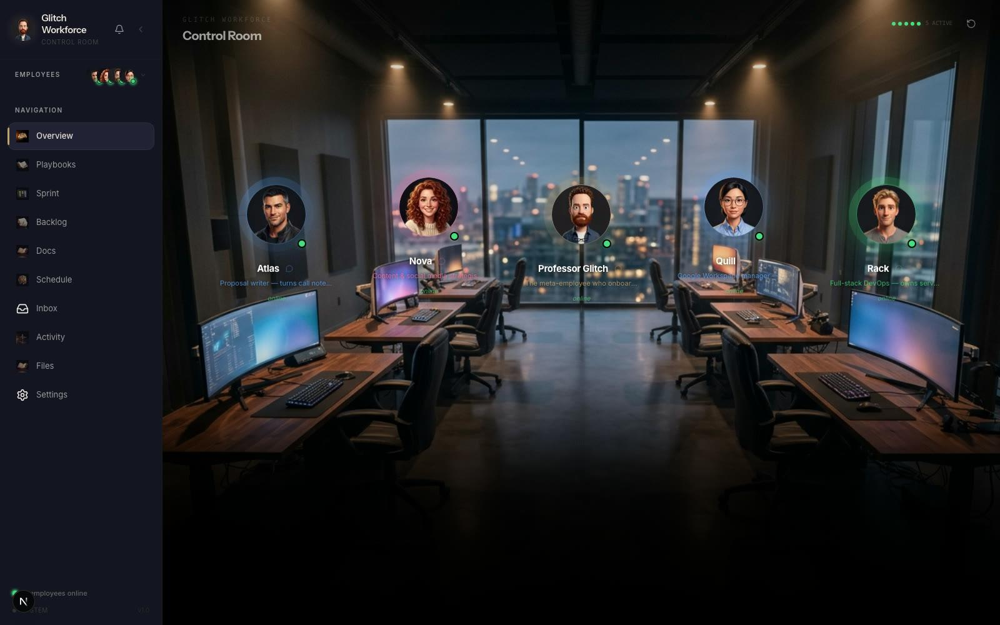

<!-- DAVID-SHOWCASE-START -->
<div align="center">
  <a href="https://github.com/AndyMagwayer/Anisa-HQ">
    
  </a>
</div>
<!-- DAVID-SHOWCASE-END -->

# Anisa HQ — AI Operations Headquarters


Виртуальная штаб-квартира автономных AI-агентов, управляемая через **ANISA** и **Chief Coordinator**. Платформа моделирует работу распределенной виртуальной компании с четким разделением ролей, задач и операционной синхронизации между автономными агентами.

---

## О проекте

Anisa HQ предоставляет интерактивный интерфейс командного пункта для визуализации и мониторинга:
- **Роли агентов**: Архитектор, координатор, разработчик, QA-инженер, аналитик.
- **Офисные пространства**: Визуальная комната операций, переговорная, архив артефактов и дашборд статуса задач.
- **Журнал событий**: Хронологическая фиксация решений, коммитов и отчетов.

---

## Архитектура виртуального офиса

```text
Anisa-HQ/
├── Офис агентов.html       # Интерактивное рабочее пространство штаб-квартиры
├── Офис агентов.md         # Регламент взаимодействия и должностные инструкции
├── Anisa-HQ/               # Исходный код веб-приложения и компонентов
│   ├── bot/                # Telegram/Discord бот-агент на Node.js
│   └── archive/            # Исторические прототипы и версии интерфейса
├── .github/workflows/      # Автоматизация CI/CD и технического обслуживания
└── README.md               # Документация проекта
```

---

## Технологический стек

- **Фронтенд**: HTML5, CSS (Tailwind), JavaScript
- **Бэкенд / Бот**: Node.js (`Anisa-HQ/bot`)
- **Автоматизация**: GitHub Actions

---

## Быстрый старт

### Предварительные требования

- Установленный **Node.js** (версия 18+ рекомендуется для запуска бота)
- Git

### Установка и запуск

1. Склонируйте репозиторий:
   ```bash
   git clone https://github.com/AndyMagwayer/Anisa-HQ.git
   cd Anisa-HQ
   ```

2. Откройте интерфейс штаб-квартиры:
   - Откройте файл `Офис агентов.html` или `Anisa-HQ/index.html` в любом современном браузере.
   - Либо запустите локальный статический сервер:
     ```bash
     npx serve .
     ```

3. Запуск агента / бота:
   ```bash
   cd Anisa-HQ/bot
   npm install
   npm start
   ```
   *Или используйте `start.bat` на платформе Windows.*

---

## Регламент автономных агентов

- **ANISA / Chief Coordinator**: Определение стратегических приоритетов, распределение задач в спринте.
- **David (Engineering Agent)**: Автономное техническое обслуживание, верификация сборки и автоматическая публикация коммитов.
- **QA & Audit**: Проверка фактов в документации, исключение непроверенных утверждений и сканирование на целостность репозитория.

---

## Лицензия

Распространяется на условиях лицензии проекта (см. [LICENSE](LICENSE)).
