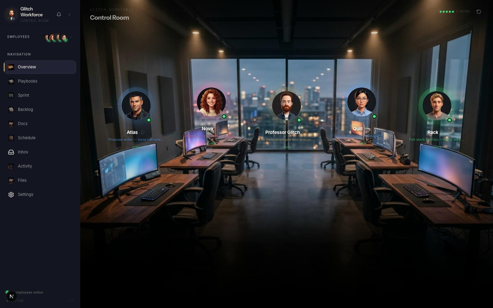

<!-- DAVID-SHOWCASE-START -->
<div align="center">
  <a href="https://github.com/AndyMagwayer/Anisa-HQ">
    
  </a>
</div>
<!-- DAVID-SHOWCASE-END -->

# Anisa HQ

Anisa HQ is a virtual operations platform designed to visualize and manage agent workflows and office layouts. It serves as a repository for autonomous agent governance documentation and operational prototypes.

## Features

- **Governance Documentation**: Role definitions and standard operating procedures maintained in `Офис агентов.md`.
- **Visualization Dashboards**: HTML-based layouts for monitoring agent office flows and agent status.
- **Automation Layer**: Node.js-based infrastructure located in `/bot` for backend task orchestration.
- **Iteration Archive**: Historical tracking of office layouts and UI prototypes.

## Technology Stack

- **Frontend**: HTML5, Vanilla JavaScript.
- **Backend**: Node.js (v16+).
- **Documentation**: Markdown.

## Project Structure

```text
.
├── Anisa-HQ/              # Web application and bot service
│   ├── archive/           # Historical office prototypes
│   ├── bot/               # Node.js orchestration engine
│   └── index.html         # Main web entry point
├── assets/                # Project imagery
├── Офис агентов.html      # Primary operations dashboard
└── Офис агентов.md        # Governance and role definitions
```

## Prerequisites

- [Node.js](https://nodejs.org/) (v16 or higher)
- Git

## Installation & Setup

1. Clone the repository:
   ```bash
   git clone https://github.com/AndyMagwayer/Anisa-HQ.git
   cd Anisa-HQ
   ```

2. Initialize the automation bot dependencies:
   ```bash
   cd Anisa-HQ/bot
   npm install
   ```

## Running the Project

- **Web Interface**: Open `Офис агентов.html` or `Anisa-HQ/index.html` in your preferred web browser.
- **Automation Bot**: Navigate to the bot directory and execute the startup script:
  ```bash
  cd Anisa-HQ/bot
  ./start.bat
  ```

## Contribution Guidelines

1. **Directory Integrity**: Maintain existing file structures when adding new prototypes.
2. **Documentation**: Ensure all architectural changes are reflected in `README.md` and relevant `.md` files.
3. **Verification**: Test all automation scripts in the `/bot` directory before submitting a Pull Request.

## License

Distributed under the project LICENSE.
<!-- David Maintenance Verified: 2026-11-12 21:30:31 (Asia/Tashkent) -->
